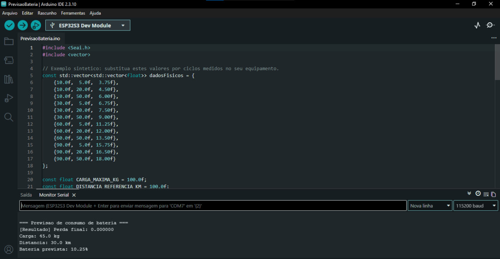
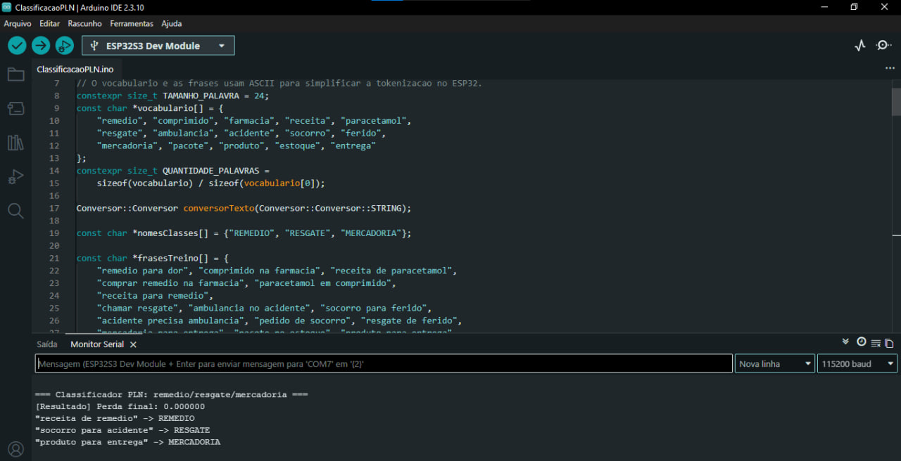
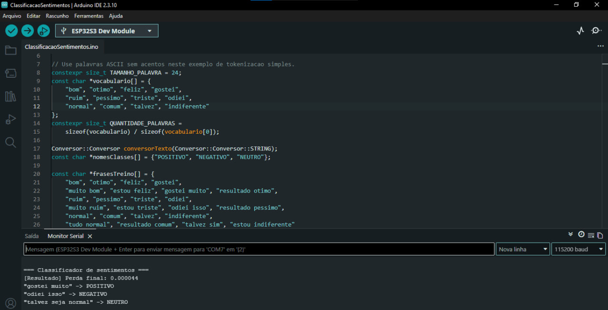
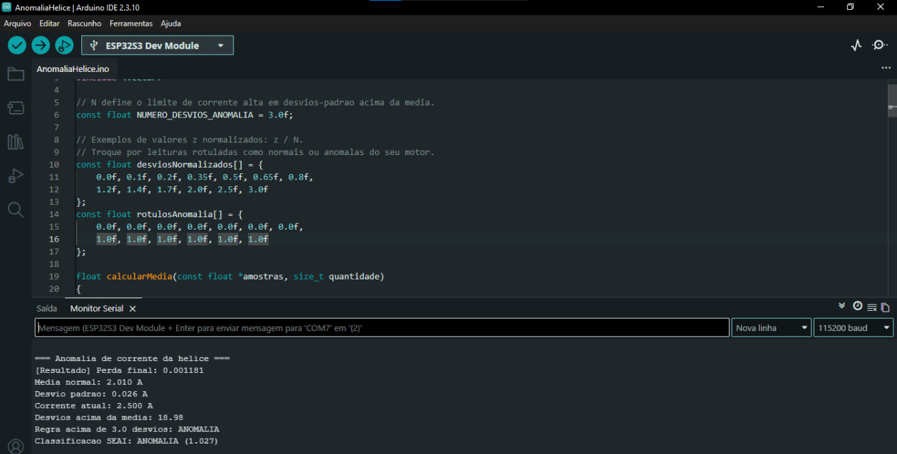

<div align="center">

# Small Embedded AI (Seai)

**Object-oriented C++ library for training and running neural networks directly on ESP32 and Raspberry Pi Pico microcontrollers.**

[](https://github.com/brunomakeram/Small-Embedded-Ai)
[](https://github.com/brunomakeram/Small-Embedded-Ai)
[](https://github.com/brunomakeram/Small-Embedded-Ai)
[](https://www.arduino.cc/)
[](https://small-embedded-ai.netlify.app/)

[Português](README.md) · **English**

</div>

Seai provides on-device training and inference, optional CSV storage, weight persistence using LittleFS/EEPROM, and serial model transfer. Its public API uses the `Seai` namespace and was revised in version 4.0.0.

> Current version: **4.0.0**. The library has been validated for ESP32 and Raspberry Pi Pico (RP2040). AVR boards, including Arduino Uno, are not supported.

## Version 4.0.0 (V4) release notes

### Removed

- The default `DATASET_PADRAO` dataset and its internal copies were removed; examples now define their training data explicitly.
- Mounting storage no longer creates dataset files by default.

### Added

- Opt-in data storage: CSV reading and writing only take place when the program explicitly calls `Seai::Armazenamento` operations.
- The `model.exportar()` and `model.importar()` methods to transfer a model over Serial at the program's request.
- Validated model import and weight persistence in board memory: LittleFS on ESP32 and EEPROM on RP2040.
- The `ferramentas/seai.py` utility, with `receber` and `enviar` commands, to save a model on the computer or transmit its CSV file.

### Improved

- The `SEAI_PESOS` CSV format is shared by ESP32 and RP2040 and delimited by the `SEAI_INICIO` and `SEAI_FIM` markers; the existing format was not replaced.
- Public APIs, examples, and documentation use the `Seai` namespace.
- Import validates the version, chained dimensions, and finite model values; import and storage workflows report failures to the user.
- Code comments and example instructions were expanded and standardized.

### Migration

- Remove any references to `DATASET_PADRAO` from your projects and declare your own training data.
- Call CSV operations or `model.importar()` only when you want to read, write, or persist data; none of these actions starts automatically.
- Update old namespace references to `Seai::`, including in examples and projects that use modules directly.

## Requirements

- Arduino IDE with the Seai library installed.
- The examples below require ESP32 and Arduino-ESP32 core 3.x.
- Model export and import also work on ESP32 and Raspberry Pi Pico (RP2040).
- The 5 AI examples on this page were validated on ESP32-S3.
- The audio recorder also requires a compatible INMP441 microphone.

## What Seai can do

The examples demonstrate word/text classification, sentiment classification, linear regression to estimate battery consumption, and motor-current anomaly analysis. They are compact examples for embedded execution; quality depends on the collected data and how representative the samples are. Text classifiers use an explicit vocabulary; they are not general-purpose language models.

## Examples tested on ESP32-S3

Open each folder as a standalone sketch in the Arduino IDE. The image references below may point to images that can be added to the repository's `imagens/` folder; executable code is available in the linked `.ino` sketches.

### Battery prediction — linear regression



[Open the PrevisaoBateria.ino sketch](examples/PrevisaoBateria/PrevisaoBateria.ino)

**Preparing the data:** record several trips. Each sample contains transported load in kg, distance traveled in km, and the percentage of battery consumed on that trip. Replace the synthetic rows in `dadosFisicos` with real measurements. Use a consistent method to measure battery percentage and include trips with varied loads and distances. The example normalizes both inputs and the target before training.

### NLP — word classification



[Open the ClassificacaoPLN.ino sketch](examples/ClassificacaoPLN/ClassificacaoPLN.ino)

**Preparing the data:** add representative sentences to `frasesTreino` and a matching label to `classesTreino`: `0` for medicine, `1` for rescue, and `2` for goods. Include a similar quantity and variety of samples for each class. Add words relevant to your domain to `vocabulario`. The sketch converts each sentence into a word-presence vector using `Conversor`. Words outside the vocabulary are ignored; the example uses ASCII text without accents.

### Sentiment classification



[Open the ClassificacaoSentimentos.ino sketch](examples/ClassificacaoSentimentos/ClassificacaoSentimentos.ino)

**Preparing the data:** each sentence in `frasesTreino` needs a label at the same position in `classesTreino`: `0` for positive, `1` for negative, and `2` for neutral. Use real sentences from your context, including spelling variations and neutral sentences, and balance examples across classes. Expand `vocabulario` with relevant words. The demonstration tokenizer uses ASCII without accents and ignores words not in the vocabulary.

### Propeller anomaly — motor-current analysis



[Open the AnomaliaHelice.ino sketch](examples/AnomaliaHelice/AnomaliaHelice.ino)

**Preparing the data:** first collect a series of current readings during normal operation and fill in `correnteNormal`; the sketch calculates the mean and standard deviation of this reference. Then set `correnteAtual` to the reading to evaluate and `NUMERO_DESVIOS_ANOMALIA` to the desired N threshold. To train with other motors, replace `desviosNormalizados` and `rotulosAnomalia` with labeled observations: each input is the current deviation from the mean, divided by the standard deviation and by N; use output `0` for normal and `1` for anomaly. The direct N-sigma rule determines whether a reading is above the threshold; Seai's classifier is an additional learned estimate.

## Using the model API

Rows in `entradas` and `saidasEsperadas` form matching samples. `executar` trains the model and computes an initial prediction; then `prever` evaluates other inputs using the same parameters.

```cpp
#include <Seai.h>
#include <vector>

Seai::Modelo model;

const std::vector<std::vector<float>> inputs = {
    {0.0f, 0.0f},
    {0.0f, 1.0f},
    {1.0f, 0.0f},
    {1.0f, 1.0f}
};
const std::vector<std::vector<float>> expectedOutputs = {
    {0.0f},
    {3.0f},
    {2.0f},
    {5.0f}
};

void setup()
{
    Serial.begin(115200);
    std::vector<float> firstInput = inputs[0];
    if (model.executar(inputs, expectedOutputs, firstInput)) {
        std::vector<float> prediction = model.prever({1.0f, 0.0f});
        if (!prediction.empty()) {
            Serial.printf("Predicted output: %.4f\n", prediction[0]);
        }
    }
}

void loop()
{
}
```

Configure `taxaAprendizado`, `epocas`, `tamanhoLote`, and `neuroniosPorCamada` before calling `executar`. Set `verbose.mostrarConfiguracao`, `verbose.mostrarNumeroEpoca`, or `verbose.mostrarPerdaPorEpoca` to enable the corresponding messages.

### High-level API

`Seai::Modelo` is the recommended interface for most projects. Its public properties let you configure training:

| Property | Type | Default | Description |
|---|---:|---:|---|
| `taxaAprendizado` | `float` | `0.05` | Size of Adam updates. |
| `epocas` | `int` | `500` | Number of passes through the training set. |
| `tamanhoLote` | `int` | `32` | Number of samples whose gradients are accumulated before updating parameters. |
| `neuroniosPorCamada` | `std::vector<int>` | `{8}` | Number of neurons in each hidden layer; the output width is determined by the targets. |
| `verbose` | `Seai::Verbose` | options off | Controls training logs. |

`executar(inputs, expectedOutputs, predictionInput)` trains and returns `true` when the data is valid. `prever(input)` performs inference after training and returns an empty vector if the model or input dimensions are invalid. All samples must have consistent dimensions and contain finite values. Hidden layers use `tanh`; the output layer is linear and therefore accepts continuous regression outputs.

`exportar()` sends the trained model over Serial in `SEAI_PESOS` CSV version 1, including dimensions, weights, and biases, between `SEAI_INICIO` and `SEAI_FIM`. `importar()` expects the same CSV over Serial, validates the data, loads the layers for inference, and writes the weights to board memory: LittleFS on ESP32 or EEPROM on Pico. Neither function runs automatically. The format and exported values are the same on both boards.

The `examples/Seai/Seai.ino` example calls these functions only when it receives a command through the serial utility: `E` exports and `I` imports. To use the utility, install PySerial (`python -m pip install pyserial`) and run:

```text
python ferramentas/seai.py receber
python ferramentas/seai.py enviar modelo.csv
```

`receber` saves the received model as `modelo.csv` (use `--saida` to choose another path). `enviar` transmits the file to the board. Both commands accept `--porta` to select the serial port directly; without it, they display the available ports.

### Low-level API

The modules can also be used separately when a project needs to control a linear layer and each training step:

| Class | Main methods | Purpose |
|---|---|---|
| `Seai::Neuronios` | `configurar`, `inicializar`, `calcular` | Holds weights and biases for a fully connected layer; supports 1 to 64 neurons. |
| `Seai::Camadas` | `adicionar`, `limpar`, `tamanho`, `operator[]` | Organizes a sequence of layers. |
| `Seai::Compilar` | `configurar` | Configures and initializes a layer and its Adam optimizer. |
| `Seai::Aprendizagem` | `treinarModelo` | Trains sample matrices for multiple epochs and returns the final MSE loss. |
| `Seai::Epocas` | `executar` | Validates data, shuffles samples, and coordinates epochs. |
| `Seai::Treinar` | `executarLotes` | Processes batches, accumulates gradients, and updates parameters. |
| `Seai::Gradientes` | `processarAmostraLote` | Computes predictions and accumulates weight and bias gradients for a sample. |
| `Seai::Prever` | `calcular` | Calculates the linear output of a configured layer. |
| `Seai::Perdas` | `calcularMSE` | Divides the sum of squared errors by the specified total. |

Example of linear regression using this interface:

```cpp
#include <Seai.h>
#include <vector>

const std::vector<std::vector<float>> inputs = {
    {0.0f, 0.0f},
    {0.0f, 1.0f},
    {1.0f, 0.0f},
    {1.0f, 1.0f}
};
const std::vector<std::vector<float>> expectedOutputs = {
    {0.0f},
    {3.0f},
    {2.0f},
    {5.0f}
};

void setup()
{
    Serial.begin(115200);

    Seai::Compilar layer;
    if (!layer.configurar(2, 1, 0.03f)) {
        Serial.println("Failed to configure layer.");
        return;
    }

    Seai::Aprendizagem learning;
    float loss = learning.treinarModelo(
        inputs, expectedOutputs, layer, 1500, 4);
    Serial.printf("MSE loss: %.6f\n", loss);

    Seai::Prever predictor;
    std::vector<float> prediction;
    if (predictor.calcular({1.0f, 0.0f}, layer.neuronios, prediction)) {
        Serial.printf("Predicted output: %.4f\n", prediction[0]);
    }
}

void loop()
{
}
```

This low-level composition configures a single linear layer. For networks with multiple hidden layers and to use `model.prever` directly, use `Seai::Modelo`.

## Training data in CSV (LittleFS)

`Seai::Armazenamento` works with `std::vector<std::vector<float>>` matrices; it does not depend on a Dataset class. The CSV has a header with arbitrary names and one numeric row per sample. In `lerDados(path, inputCount, inputs, outputs)`, `inputCount` specifies how many initial columns are inputs; the remaining columns are outputs. The header must contain at least one column of each type, and all rows must have the same number of fields.

| Method | Description |
|---|---|
| `montar(path)` | Mounts LittleFS without creating or writing a data file. |
| `lerDados(path, inputCount, inputs, outputs)` | Reads the CSV and separates the input and output matrices. |
| `gravarDados(path, inputNames, outputNames, inputs, outputs)` | Writes a new CSV with column names and the supplied matrices. |
| `gravarRegistro(path, inputs, outputs)` | Appends a sample using the column order already present in the file. |

Storage is optional: by default, the library does not create or write datasets. Explicitly call `Armazenamento` methods to mount LittleFS and read or write data. This CSV data module is available on ESP32; model-weight persistence also supports EEPROM on Pico.

Example of writing and reading. The header names the columns; the split position is still specified by `inputCount`:

```cpp
#include <Seai.h>
#include <vector>

void csvExample()
{
    Seai::Armazenamento storage;
    const char *path = "/training.csv";
    const std::vector<String> inputNames = {"load_kg", "distance_km"};
    const std::vector<String> outputNames = {"battery_used"};
    const std::vector<std::vector<float>> inputs = {
        {10.0f, 5.0f},
        {30.0f, 20.0f}
    };
    const std::vector<std::vector<float>> outputs = {
        {3.75f},
        {7.50f}
    };

    if (!storage.montar(path) ||
        !storage.gravarDados(
            path, inputNames, outputNames, inputs, outputs)) {
        Serial.println("Failed to prepare CSV.");
        return;
    }

    std::vector<std::vector<float>> loadedInputs;
    std::vector<std::vector<float>> loadedOutputs;
    if (storage.lerDados(
            path, inputNames.size(), loadedInputs, loadedOutputs)) {
        Serial.printf("Samples read: %u\n", (unsigned)loadedInputs.size());
    }
}
```

## Adam and data conversion

`Seai::Adam` stores optimizer moments in vectors, one value per parameter; there is no fixed limit of three parameters. Its constructor and `inicializar` accept the learning rate, first-moment decay, second-moment decay, and numerical epsilon. `atualizarParametros` receives the parameter vector, accumulated gradients, and batch sample count. It computes the local average of gradients without modifying the input vector.

Example updating five parameters:

```cpp
Seai::Adam optimizer(0.01f);
std::vector<float> parameters = {1.0f, 2.0f, 3.0f, 4.0f, 5.0f};
const std::vector<float> gradients = {0.1f, 0.2f, 0.3f, 0.4f, 0.5f};
optimizer.atualizarParametros(parameters, gradients, 4);
```

`Seai::Conversor` converts values between `FLOAT32`, integers, and `STRING`. Available types are `FLOAT32`, `INT32`, `INT16`, `INT8`, `UINT8`, and `STRING`. `tamanhoBytes()` reports the width of numeric types. `converterDado(destinationType, input, output, count, inputWidth, outputWidth)` converts a vector of values; widths are required when the source or destination is `STRING`. `larguraMinima` calculates the space needed to store the longest word in a set of fixed-width strings.

```cpp
#include <Seai.h>

Seai::Conversor converter(Seai::Conversor::STRING);
uint8_t words[2][16] = {"ligar", "desligar"};
uint8_t copy[2][16] = {};

void setup()
{
    bool converted = converter.converterDado(
        Seai::Conversor::STRING,
        &words[0][0],
        &copy[0][0],
        2,
        16,
        16);
    Serial.println(converted ? "Conversion complete." : "Conversion failed.");
}

void loop()
{
}
```

`Seai::Verbose` lets you independently enable `mostrarConfiguracao`, `mostrarNumeroEpoca`, and `mostrarPerdaPorEpoca`. In the model, configure these options through `model.verbose` before calling `executar`.

## Audio recorder

In addition to training and running embedded models, Seai can communicate over the serial port with a Python script on a computer to record audio on the board and transfer recordings to the computer. The script menu lets you listen to, save, or delete recordings.

This workflow uses the `examples/GravadorExemplo/GravadorExemplo.ino` sketch and the `ferramentas/gravadorVoz/principal.py` script. It requires a compatible board and microphone, the script and its dependencies, and the board's serial port.

In the sketch, `Seai::Gravador(durationSeconds, pinBclk, pinWs, pinDin)` configures the duration (limited to 1–10 seconds) and I2S pins; defaults are 2 seconds and GPIO 4, 5, and 9. `iniciar()` prepares capture and opens Serial at 921600 baud. Call `gravar()` repeatedly in `loop()`: when it receives `G` over Serial, the recorder captures 16 kHz/16-bit mono PCM audio and sends the WAV header and binary data over the same port.

```cpp
#include <Seai.h>

Seai::Gravador recorder(2, 4, 5, 9);

void setup()
{
    recorder.iniciar();
}

void loop()
{
    recorder.gravar();
}
```

1. Open the recorder sketch in the Arduino IDE.
2. Connect the board using a data-capable USB cable and select the correct board and port.
3. Upload the sketch and wait for it to finish.
4. Close the Serial Monitor to release the serial port.
5. Follow the installation and usage instructions in [`ferramentas/gravadorVoz/README.md`](ferramentas/gravadorVoz/README.md).
6. In the script menu, select the port, enter the word label, and speak when the LED turns green.
7. Listen to, save, or delete the recording using the displayed options.

## References

- [Small Embedded AI library website](https://small-embedded-ai.netlify.app/)
- [Library repository and examples](https://github.com/brunomakeram/Small-Embedded-Ai)
- [Official Arduino IDE documentation](https://docs.arduino.cc/software/ide-v2/)
- [Official Arduino library documentation](https://docs.arduino.cc/software/ide-v2/tutorials/ide-v2-installing-a-library/)
- [Espressif ESP-IDF I2S documentation](https://docs.espressif.com/projects/esp-idf/en/stable/esp32/api-reference/peripherals/i2s.html)
- [Official Arduino-ESP32 installation documentation](https://docs.espressif.com/projects/arduino-esp32/en/latest/installing.html)
- [Python tutorial](https://docs.python.org/3/tutorial/)
- [PySerial documentation](https://pyserial.readthedocs.io/en/latest/)
- [Project glossary (Portuguese)](GLOSSARIO.md)
