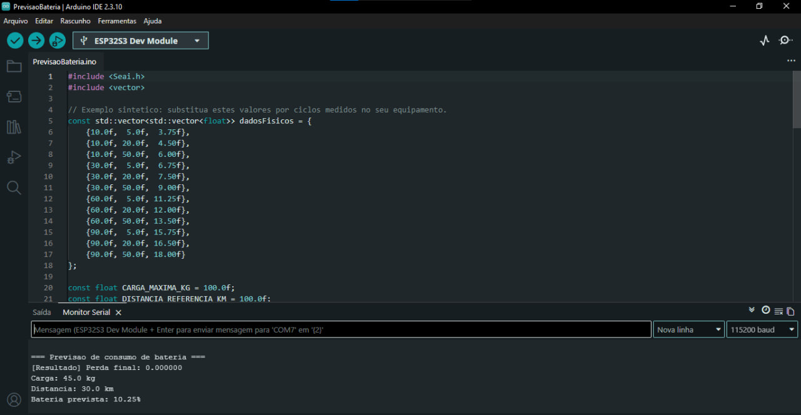
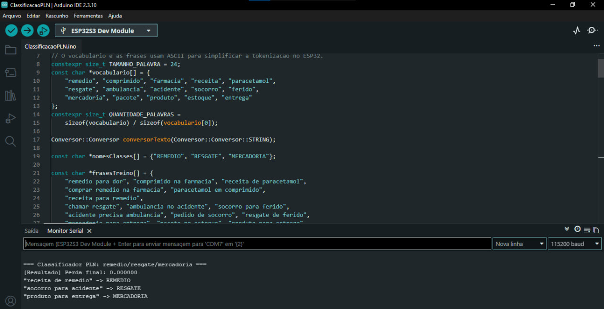
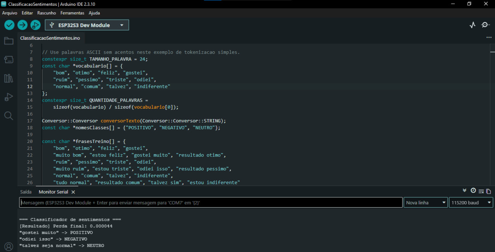
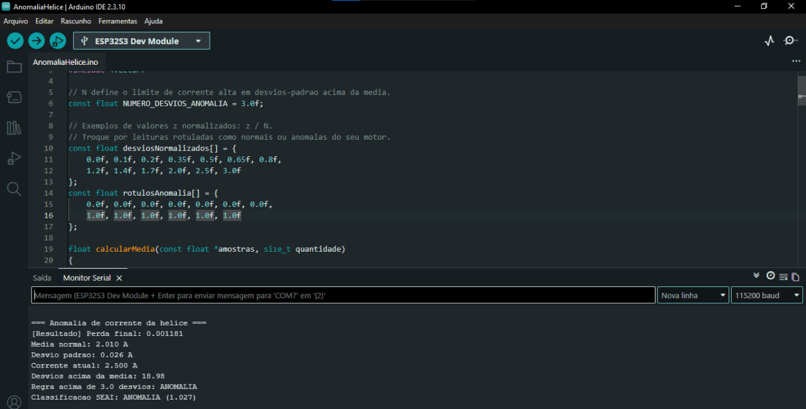
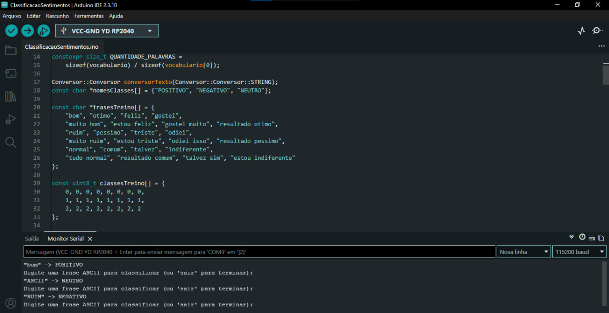
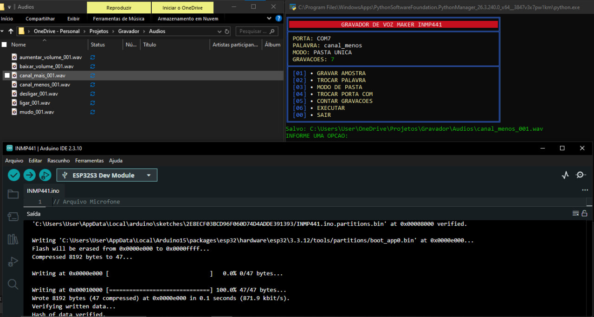

<div align="center">

# Small Embedded AI (Seai)

Biblioteca C++ orientada a objetos para treinar e executar redes neurais diretamente em microcontroladores ESP32 e Raspberry Pi Pico.

[](https://github.com/brunomakeram/Small-Embedded-Ai)
[](https://github.com/brunomakeram/Small-Embedded-Ai)
[](https://github.com/brunomakeram/Small-Embedded-Ai)
[](https://www.arduino.cc/)
[](https://small-embedded-ai.netlify.app/)
[](LICENSE)

[Português] · [English](README.en.md)

</div>

Seai oferece treinamento on-device, inferência, armazenamento opcional em CSV, persistência de pesos em LittleFS/EEPROM e transferência serial de modelos. A API pública usa o namespace `Seai` e foi revisada na versão 4.0.0.

> Versão atual: **4.0.0**. A biblioteca foi validada para ESP32 e Raspberry Pi Pico (RP2040). AVR, incluindo Arduino Uno, não é suportado.

## Notas da versão 4.0.0 (V4)

### Removido

- O dataset padrão `DATASET_PADRAO` e suas cópias internas foram removidos; os exemplos agora definem explicitamente os dados de treino.
- A montagem do armazenamento deixou de criar arquivos de dataset por padrão.

### Adicionado

- Armazenamento de dados opt-in: leitura e gravação em CSV só ocorrem quando o programa chama explicitamente as operações de `Seai::Armazenamento`.
- Os métodos `modelo.exportar()` e `modelo.importar()` para transferir um modelo pela Serial sob solicitação do programa.
- Importação validada e persistência dos pesos na memória da placa: LittleFS no ESP32 e EEPROM no RP2040.
- A ferramenta `ferramentas/seai.py`, com os comandos `receber` e `enviar`, para salvar no computador ou transmitir o CSV do modelo.

### Melhorado

- O formato CSV `SEAI_PESOS` é compartilhado por ESP32 e RP2040, delimitado pelos marcadores `SEAI_INICIO` e `SEAI_FIM`; o formato existente não foi substituído por outro.
- As APIs públicas, os exemplos e a documentação usam o namespace `Seai`.
- A importação valida versão, dimensões encadeadas e valores finitos do modelo; os fluxos de importação e armazenamento reportam falhas ao usuário.
- Os comentários de código e as instruções dos exemplos foram detalhados e padronizados.

### Migração

- Remova dos projetos qualquer referência a `DATASET_PADRAO` e declare seus próprios dados de treino.
- Chame as operações de CSV ou `modelo.importar()` somente quando desejar ler, gravar ou persistir dados; nenhuma dessas ações é iniciada automaticamente.
- Atualize referências antigas de namespace para `Seai::`, inclusive nos exemplos e nos projetos que usam os módulos diretamente.

## Requisitos

- Arduino IDE com a biblioteca Seai instalada.
- Para os exemplos abaixo: ESP32 e Arduino-ESP32 core 3.x.
- A exportação e importação de modelos também funcionam em ESP32 e Raspberry Pi Pico (RP2040).
- Os 5 exemplos de IA desta página foram validados na ESP32-S3.
- O gravador de áudio também requer microfone INMP441 compatível.

## O que a Seai pode fazer

Os exemplos demonstram classificação de palavras/textos, classificação de sentimentos, regressão linear para estimar consumo de bateria e análise de anomalias pela corrente do motor. São exemplos compactos para execução embarcada; a qualidade depende dos dados coletados e da representatividade das amostras. Os classificadores de texto usam um vocabulário explícito, não um modelo de linguagem geral.

## Exemplos testados na ESP32-S3

Abra cada pasta como sketch independente na Arduino IDE. As referências abaixo apontam para imagens que poderão ser adicionadas à pasta `imagens/` do GitHub; o código executável fica nos links `.ino`.

### Previsão de bateria — regressão linear



[Abrir o sketch PrevisaoBateria.ino](examples/PrevisaoBateria/PrevisaoBateria.ino)

**Como montar os dados:** registre várias viagens. Cada amostra contém carga transportada em kg, distância percorrida em km e percentual de bateria gasto naquela viagem. Substitua as linhas sintéticas de `dadosFisicos` por medições reais. Mantenha o método de medição do percentual consistente e inclua viagens com cargas e distâncias variadas. O exemplo normaliza as duas entradas e o alvo antes do treino.

### PLN — classificação de palavras



[Abrir o sketch ClassificacaoPLN.ino](examples/ClassificacaoPLN/ClassificacaoPLN.ino)

**Como montar os dados:** adicione frases representativas a `frasesTreino` e um rótulo correspondente em `classesTreino`: `0` para remédio, `1` para resgate e `2` para mercadoria. Inclua quantidade e variedade semelhantes por classe. Adicione ao `vocabulario` palavras importantes para o seu domínio. O sketch transforma cada frase num vetor de presença de palavras usando `Conversor`. Palavras fora do vocabulário são ignoradas; o exemplo usa texto ASCII sem acentos.

### Classificação de sentimentos



[Abrir o sketch ClassificacaoSentimentos.ino](examples/ClassificacaoSentimentos/ClassificacaoSentimentos.ino)

**Como montar os dados:** cada frase em `frasesTreino` precisa do rótulo na mesma posição em `classesTreino`: `0` para positivo, `1` para negativo e `2` para neutro. Use frases reais do seu contexto, incluindo variações de escrita, frases neutras e exemplos equilibrados entre classes. Amplie o `vocabulario` com palavras relevantes. A tokenização de demonstração usa ASCII sem acentos e ignora palavras que não estejam no vocabulário.

### Anomalia de hélice — análise da corrente do motor



[Abrir o sketch AnomaliaHelice.ino](examples/AnomaliaHelice/AnomaliaHelice.ino)

**Como montar os dados:** primeiro colete uma série de leituras de corrente durante operação normal e preencha `correnteNormal`; o sketch calcula a média e o desvio-padrão dessa referência. Depois ajuste `correnteAtual` com a leitura que será avaliada e `NUMERO_DESVIOS_ANOMALIA` com o limite N desejado. Para treinar com outros motores, substitua `desviosNormalizados` e `rotulosAnomalia` por observações rotuladas: cada entrada é o desvio da corrente em relação à média, dividido pelo desvio-padrão e por N; use saída `0` para normal e `1` para anomalia. A regra direta N-sigma determina se a leitura está acima do limite; a classificação da Seai é uma estimativa aprendida adicional.

### Raspberry Pi Pico — RP2040



## Uso da API de modelo

As linhas de `entradas` e `saidasEsperadas` formam amostras correspondentes. `executar` treina o modelo e calcula uma previsão inicial; depois, `prever` avalia outras entradas com os mesmos parâmetros.

```cpp
#include <Seai.h>
#include <vector>

Seai::Modelo modelo;

const std::vector<std::vector<float>> entradas = {
    {0.0f, 0.0f},
    {0.0f, 1.0f},
    {1.0f, 0.0f},
    {1.0f, 1.0f}
};
const std::vector<std::vector<float>> saidasEsperadas = {
    {0.0f},
    {3.0f},
    {2.0f},
    {5.0f}
};

void setup()
{
    Serial.begin(115200);
    std::vector<float> primeiraEntrada = entradas[0];
    if (modelo.executar(entradas, saidasEsperadas, primeiraEntrada)) {
        std::vector<float> previsao = modelo.prever({1.0f, 0.0f});
        if (!previsao.empty()) {
            Serial.printf("Saida prevista: %.4f\n", previsao[0]);
        }
    }
}

void loop()
{
}
```

Configure `taxaAprendizado`, `epocas`, `tamanhoLote` e `neuroniosPorCamada` antes de chamar `executar`. Configure `verbose.mostrarConfiguracao`, `verbose.mostrarNumeroEpoca` ou `verbose.mostrarPerdaPorEpoca` para habilitar as respectivas mensagens.

### API de alto nível

`Seai::Modelo` é a interface recomendada para a maioria dos projetos. Suas propriedades públicas permitem configurar o treino:

| Propriedade | Tipo | Padrão | Uso |
|---|---:|---:|---|
| `taxaAprendizado` | `float` | `0.05` | Tamanho das atualizações do Adam. |
| `epocas` | `int` | `500` | Quantas vezes percorrer o conjunto de treino. |
| `tamanhoLote` | `int` | `32` | Quantas amostras acumulam gradientes antes de atualizar os parâmetros. |
| `neuroniosPorCamada` | `std::vector<int>` | `{8}` | Número de neurônios em cada camada oculta; a saída é dimensionada pelos alvos. |
| `verbose` | `Seai::Verbose` | opções desligadas | Controla os registros do treino. |

`executar(entradas, saidasEsperadas, entradaPrevisao)` treina e retorna `true` quando os dados são válidos. `prever(entrada)` faz inferência após o treino e retorna um vetor vazio se o modelo ou a dimensão da entrada forem inválidos. Todas as amostras precisam ter dimensões consistentes e conter valores finitos. As camadas ocultas usam `tanh`; a camada de saída é linear, portanto aceita saídas contínuas para regressão.

`exportar()` envia o modelo treinado pela Serial no CSV `SEAI_PESOS` versão 1, com dimensões, pesos e vieses, entre `SEAI_INICIO` e `SEAI_FIM`. `importar()` espera esse mesmo CSV pela Serial, valida os dados, carrega as camadas para previsão e grava os pesos na memória da placa: LittleFS no ESP32 ou EEPROM no Pico. Nenhuma dessas funções roda automaticamente. O formato e os valores exportados são iguais nas duas placas.

O exemplo `examples/Seai/Seai.ino` chama essas funções somente quando recebe um comando pela ferramenta serial: `E` exporta e `I` importa. Para usar a ferramenta, instale o PySerial (`python -m pip install pyserial`) e execute:

```text
python ferramentas/seai.py receber
python ferramentas/seai.py enviar modelo.csv
```

`receber` salva o modelo recebido em `modelo.csv` (use `--saida` para escolher outro caminho). `enviar` transmite o arquivo para a placa. Ambos aceitam `--porta` para selecionar diretamente a porta serial; sem essa opção, exibem as portas disponíveis.

#### Ferramenta de transferência serial



### API de baixo nível

Os módulos podem ser usados separadamente quando o projeto precisa controlar os componentes e as etapas do treinamento. A tabela abaixo cita todas as classes declaradas nos módulos da biblioteca. `Armazenamento` está disponível no ESP32; `Gravador` depende do suporte I2S/ESP32 compatível. `Dataset` continua declarado como estrutura auxiliar legada, mas não é incluído pelo cabeçalho central `Seai.h` e não representa um dataset padrão da V4.

| Classe | Métodos/membros principais | Função |
|---|---|---|
| `Seai::Adam` | `inicializar`, `atualizarParametros` | Otimizador Adam; mantém os momentos e atualiza pesos e vieses. |
| `Seai::Aprendizagem` | `treinarModelo` | Encaminha matrizes de amostras ao executor de épocas e retorna a perda MSE final. |
| `Seai::Armazenamento` | `montar`, `lerDados`, `gravarDados`, `gravarRegistro` | Lê e grava matrizes numéricas CSV no LittleFS (ESP32). |
| `Seai::Camadas` | `adicionar`, `limpar`, `tamanho`, `operator[]` | Organiza e dá acesso às camadas da rede. |
| `Seai::Compilar` | `configurar`, `neuronios`, `otimizador` | Configura uma camada linear e o otimizador Adam para treino de baixo nível. |
| `Seai::Conversor` | `tamanhoBytes`, `converterDado`, `tipoDestino`, `larguraMinima` | Converte valores entre `FLOAT32`, inteiros e strings. |
| `Seai::Dataset` | `carga`, `distancia`, `gasto` | Estrutura auxiliar legada para armazenar vetores paralelos; não é necessária para declarar os dados de treino da V4. |
| `Seai::Epocas` | `executar` | Valida dados, embaralha amostras e coordena as épocas do treino. |
| `Seai::Gradientes` | `processarAmostraLote` | Calcula previsões e acumula gradientes de pesos e vieses por amostra. |
| `Seai::Gravador` | `iniciar`, `gravar` | Captura áudio PCM via I2S e envia WAV pela Serial em hardware compatível. |
| `Seai::Modelo` | `executar`, `prever`, `exportar`, `importar` | API de alto nível para treinamento, inferência e transferência/persistência do modelo. |
| `Seai::Neuronios` | `configurar`, `inicializar`, `calcular` | Mantém pesos e vieses de uma camada totalmente conectada; aceita de 1 a 64 neurônios. |
| `Seai::Perdas` | `calcularMSE` | Calcula o erro quadrático médio a partir da soma de erros e da quantidade avaliada. |
| `Seai::Pesos` | `exportarCsv`, `importarCsv`, `salvar` | Serializa, valida, importa e persiste os pesos do modelo. |
| `Seai::Prever` | `calcular` | Calcula a saída linear de uma camada configurada. |
| `Seai::Treinar` | `executarLotes` | Processa lotes, acumula gradientes, calcula perdas e atualiza parâmetros. |
| `Seai::Verbose` | `registrarConfiguracao`, `registrarEpoca`, `registrarPerdaEpoca` | Controla mensagens de configuração e acompanhamento do treino pela Serial. |

Exemplo de regressão linear usando componentes de baixo nível:

```cpp
#include <Seai.h>
#include <vector>

const std::vector<std::vector<float>> entradas = {
    {0.0f, 0.0f},
    {0.0f, 1.0f},
    {1.0f, 0.0f},
    {1.0f, 1.0f}
};
const std::vector<std::vector<float>> saidasEsperadas = {
    {0.0f},
    {3.0f},
    {2.0f},
    {5.0f}
};

void setup()
{
    Serial.begin(115200);

    Seai::Compilar camada;
    if (!camada.configurar(2, 1, 0.03f)) {
        Serial.println("Falha ao configurar a camada.");
        return;
    }

    Seai::Aprendizagem aprendizagem;
    float perda = aprendizagem.treinarModelo(
        entradas, saidasEsperadas, camada, 1500, 4);
    Serial.printf("Perda MSE: %.6f\n", perda);

    Seai::Prever previsor;
    std::vector<float> previsao;
    if (previsor.calcular({1.0f, 0.0f}, camada.neuronios, previsao)) {
        Serial.printf("Saida prevista: %.4f\n", previsao[0]);
    }
}

void loop()
{
}
```

Essa composição de baixo nível configura uma única camada linear. Para redes com várias camadas ocultas e para usar diretamente `modelo.prever`, utilize `Seai::Modelo`.

## Dados de treino em CSV (LittleFS)

`Seai::Armazenamento` trabalha com matrizes `std::vector<std::vector<float>>`; não depende de uma classe Dataset. O CSV tem um cabeçalho com nomes livres e uma linha numérica por amostra. Em `lerDados(caminho, quantidadeEntradas, entradas, saidas)`, o argumento `quantidadeEntradas` define quantas colunas iniciais são entradas; as demais colunas são saídas. O cabeçalho deve conter pelo menos uma coluna de cada tipo, e todas as linhas devem ter o mesmo número de campos.

| Método | O que faz |
|---|---|
| `montar(caminho)` | Monta o LittleFS sem criar ou gravar um arquivo de dados. |
| `lerDados(caminho, quantidadeEntradas, entradas, saidas)` | Lê o CSV e separa as matrizes de entrada e saída. |
| `gravarDados(caminho, nomesEntradas, nomesSaidas, entradas, saidas)` | Grava um CSV novo com os nomes de coluna e as matrizes fornecidas. |
| `gravarRegistro(caminho, entradas, saidas)` | Acrescenta uma amostra respeitando a ordem das colunas já existente no arquivo. |

O armazenamento é opcional: por padrão, a biblioteca não cria nem grava datasets. Chame explicitamente os métodos de `Armazenamento` para montar o LittleFS e ler ou gravar dados. Esse módulo de dados CSV está disponível no ESP32; a persistência de pesos do modelo também oferece EEPROM no Pico.

Exemplo de gravação e leitura. O cabeçalho nomeia as colunas; a posição de separação continua sendo informada por `quantidadeEntradas`:

```cpp
#include <Seai.h>
#include <vector>

void exemploCsv()
{
    Seai::Armazenamento armazenamento;
    const char *caminho = "/treino.csv";
    const std::vector<String> nomesEntradas = {"carga_kg", "distancia_km"};
    const std::vector<String> nomesSaidas = {"bateria_gasta"};
    const std::vector<std::vector<float>> entradas = {
        {10.0f, 5.0f},
        {30.0f, 20.0f}
    };
    const std::vector<std::vector<float>> saidas = {
        {3.75f},
        {7.50f}
    };

    if (!armazenamento.montar(caminho) ||
        !armazenamento.gravarDados(
            caminho, nomesEntradas, nomesSaidas, entradas, saidas)) {
        Serial.println("Falha ao preparar o CSV.");
        return;
    }

    std::vector<std::vector<float>> entradasLidas;
    std::vector<std::vector<float>> saidasLidas;
    if (armazenamento.lerDados(
            caminho, nomesEntradas.size(), entradasLidas, saidasLidas)) {
        Serial.printf("Amostras lidas: %u\n", (unsigned)entradasLidas.size());
    }
}
```

## Adam e conversão

`Seai::Adam` mantém os momentos do otimizador em vetores, um valor para cada parâmetro; não há limite fixo de três parâmetros. O construtor e `inicializar` aceitam taxa de aprendizado, decaimento do primeiro momento, decaimento do segundo momento e margem numérica. `atualizarParametros` recebe o vetor de parâmetros, os gradientes acumulados e o número de amostras do lote. Calcula a média local dos gradientes sem alterar o vetor recebido.

Exemplo de atualização de cinco parâmetros:

```cpp
Seai::Adam otimizador(0.01f);
std::vector<float> parametros = {1.0f, 2.0f, 3.0f, 4.0f, 5.0f};
const std::vector<float> gradientes = {0.1f, 0.2f, 0.3f, 0.4f, 0.5f};
otimizador.atualizarParametros(parametros, gradientes, 4);
```

`Seai::Conversor` converte valores entre `FLOAT32`, inteiros e `STRING`. Os tipos disponíveis são `FLOAT32`, `INT32`, `INT16`, `INT8`, `UINT8` e `STRING`. `tamanhoBytes()` informa a largura dos tipos numéricos. `converterDado(tipoDestino, entrada, saida, quantidade, larguraEntrada, larguraSaida)` converte um vetor de valores; as larguras são necessárias para origem ou destino `STRING`. `larguraMinima` calcula o espaço necessário para guardar a maior palavra de um conjunto de strings de largura fixa.

```cpp
#include <Seai.h>

Seai::Conversor conversor(Seai::Conversor::STRING);
uint8_t palavras[2][16] = {"ligar", "desligar"};
uint8_t copia[2][16] = {};

void setup()
{
    bool convertido = conversor.converterDado(
        Seai::Conversor::STRING,
        &palavras[0][0],
        &copia[0][0],
        2,
        16,
        16);
    Serial.println(convertido ? "Conversao concluida." : "Falha na conversao.");
}

void loop()
{
}
```

`Seai::Verbose` permite habilitar separadamente `mostrarConfiguracao`, `mostrarNumeroEpoca` e `mostrarPerdaPorEpoca`. No modelo, configure essas opções por `modelo.verbose` antes de chamar `executar`.

## Gravador de áudio

Além de treinar e executar modelos embarcados, a Seai pode se comunicar pela porta serial com um script Python no notebook para gravar áudio na placa e transferir as gravações para o computador. Pelo menu do script, é possível ouvir as gravações, salvá-las no notebook ou excluí-las.

O fluxo corresponde ao sketch `examples/GravadorExemplo/GravadorExemplo.ino` e ao script `ferramentas/gravadorVoz/principal.py`. Requer placa e microfone compatíveis, script e dependências instalados, além da porta serial da placa.

No sketch, `Seai::Gravador(tempoSegundos, pinoBclk, pinoWs, pinoDin)` configura a duração (limitada de 1 a 10 segundos) e os pinos I2S; os valores padrão são 2 segundos e GPIO 4, 5 e 9. `iniciar()` prepara a captura e abre a Serial em 921600 baud. Chame `gravar()` repetidamente em `loop()`: ao receber `G` pela Serial, o gravador captura áudio mono PCM de 16 kHz/16 bits e envia o cabeçalho WAV e os dados binários pela mesma porta.

```cpp
#include <Seai.h>

Seai::Gravador gravador(2, 4, 5, 9);

void setup()
{
    gravador.iniciar();
}

void loop()
{
    gravador.gravar();
}
```

1. Abra o sketch do gravador na Arduino IDE.
2. Conecte a placa pelo cabo USB de dados e selecione a placa e porta corretas.
3. Envie o sketch e aguarde o carregamento.
4. Feche o Serial Monitor para liberar a porta serial.
5. Siga as instruções de instalação e execução em [`ferramentas/gravadorVoz/README.md`](ferramentas/gravadorVoz/README.md).
6. No menu do script, selecione a porta, informe o rótulo da palavra e fale quando o LED ficar verde.
7. Ouça, salve ou exclua a gravação pelas opções apresentadas.

## Referências

- [Site da biblioteca Small Embedded AI](https://s-e-ai.netlify.app/)
- [Repositório e exemplos da biblioteca](https://github.com/brunomakeram/Small-Embedded-Ai)
- [Documentação oficial da Arduino IDE](https://docs.arduino.cc/software/ide-v2/)
- [Documentação oficial Arduino — bibliotecas](https://docs.arduino.cc/software/ide-v2/tutorials/ide-v2-installing-a-library/)
- [Documentação Espressif ESP-IDF — I2S](https://docs.espressif.com/projects/esp-idf/en/stable/esp32/api-reference/peripherals/i2s.html)
- [Documentação oficial Arduino-ESP32 — instalação](https://docs.espressif.com/projects/arduino-esp32/en/latest/installing.html)
- [Documentação Python — tutorial](https://docs.python.org/3/tutorial/)
- [PySerial — documentação](https://pyserial.readthedocs.io/en/latest/)
- [Glossário do projeto](GLOSSARIO.md)

## 🚀 Próximos projetos

Outros projetos de sistemas embarcados serão postados em breve, com níveis de complexidade maiores.

---

## 👤 Autor: Bruno Maker
