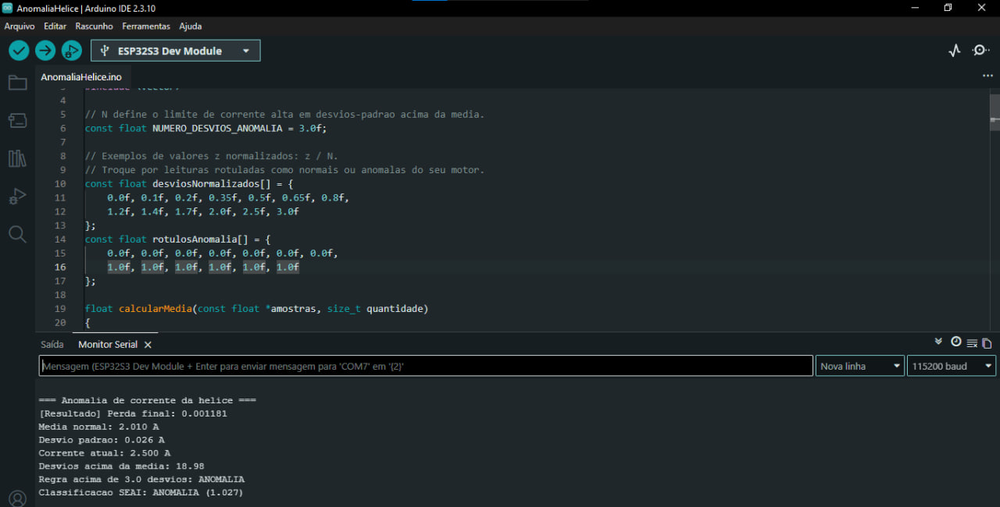
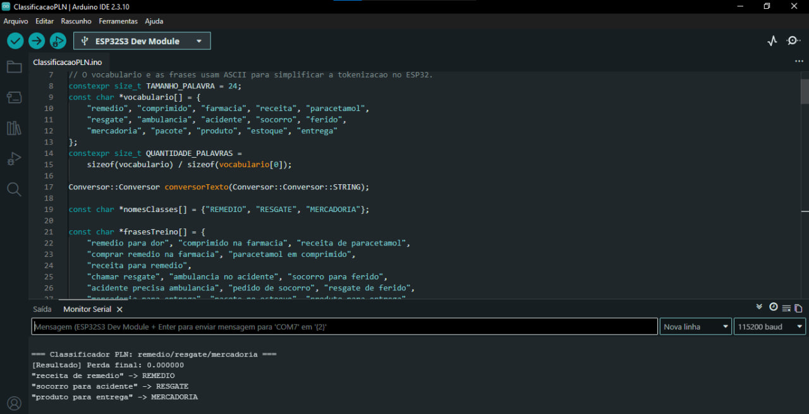
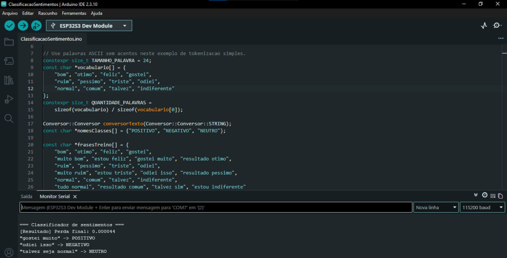
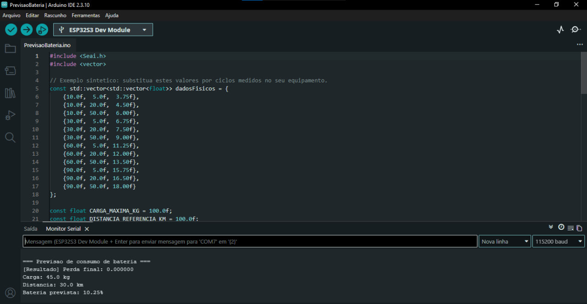
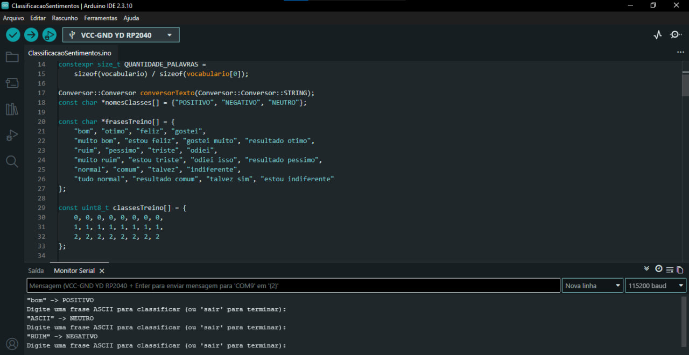
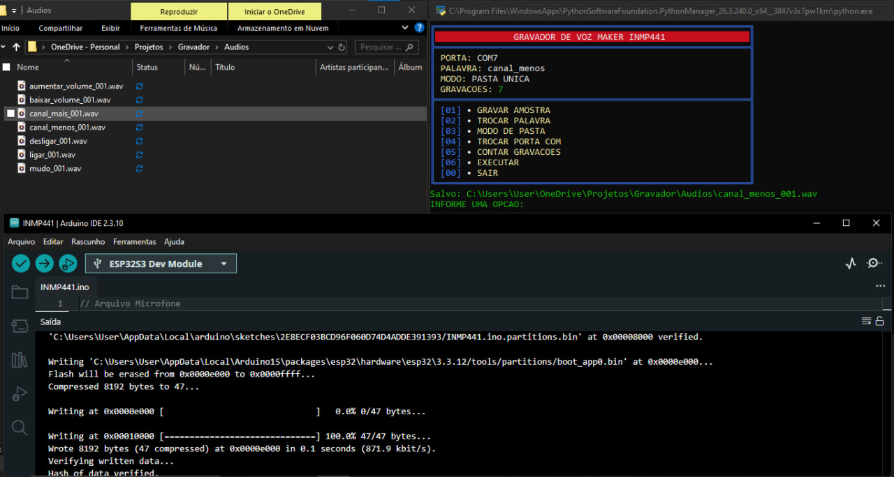

<div align="center">

# Small Embedded AI (Seai) — v3.0.0

**Treinamento e inferência de redes neurais diretamente em ESP32 e Raspberry Pi Pico (RP2040).**

[](https://github.com/brunomakeram/Small-Embedded-Ai)
[](https://github.com/brunomakeram/Small-Embedded-Ai)
[](https://github.com/brunomakeram/Small-Embedded-Ai)
[](https://www.arduino.cc/)
[](https://small-embedded-ai.netlify.app/)

[**Português**](README.md) · [English](README.en.md)

</div>

Seai é uma biblioteca C++ modular para treinar e executar redes neurais leves diretamente em microcontroladores suportados. Ela oferece uma API orientada a objetos para modelos, otimizador Adam, treinamento em lotes, inferência, persistência opcional de pesos, utilitários CSV e captura de áudio I2S.

> **Escopo:** esta documentação acompanha a versão **3.0.0**. As arquiteturas suportadas são ESP32 e Raspberry Pi Pico (RP2040). Placas AVR, incluindo Arduino Uno, não são suportadas.

## Índice

- [Recursos](#recursos)
- [Hardware e requisitos](#hardware-e-requisitos)
- [Instalação](#instalação)
- [Início rápido](#início-rápido)
- [Referência da API](#referência-da-api)
- [Galeria de imagens](#galeria-de-imagens-e-caminhos-dos-arquivos)
- [Exemplos do repositório](#exemplos-do-repositório)
- [Módulos auxiliares](#módulos-auxiliares)
- [Limitações e recomendações](#limitações-e-recomendações)
- [Licença e créditos](#licença-e-créditos)

## Recursos

- Treinamento embarcado de redes neurais feed-forward a partir de matrizes numéricas.
- Camadas ocultas configuráveis, épocas, lotes e taxa de aprendizado.
- Otimização Adam e retropropagação do erro.
- Inferência usando `prever(...)` e cálculo do MSE em `perdaFinal`.
- Persistência opcional de pesos, leitura/escrita CSV via LittleFS e captura de áudio I2S.
- Logs pela Serial por meio de `Verbose`.

## Hardware e requisitos

| Item | Requisito / situação |
|---|---|
| Arquiteturas suportadas | ESP32 e RP2040 (família Raspberry Pi Pico) |
| Ambiente Arduino | Arduino IDE com a biblioteca Seai instalada |
| Placas AVR | Não suportadas, incluindo Arduino Uno |
| Gravador de áudio | ESP32-S3, Arduino-ESP32 core 3.x e microfone INMP441 compatível |
| Exemplo RP2040 | Core Arduino-Pico e perfil compatível com a placa/flash selecionada |

## Instalação

Instale a Seai como biblioteca Arduino usando este repositório ou a pasta da biblioteca. O arquivo `library.properties` declara nome `Seai`, versão `3.0.0` e arquiteturas `esp32,rp2040`.

```bash
git clone https://github.com/brunomakeram/Small-Embedded-Ai.git
```

Abra cada sketch individualmente em `examples/`, selecione a placa e a porta e siga as instruções do exemplo.

## Início rápido

O cabeçalho público `Seai.h` inclui os módulos compatíveis com a arquitetura detectada. A interface recomendada para a maioria dos projetos é `Modelo::Modelo`.

```cpp
#include <Seai.h>
#include <vector>

Modelo::Modelo modelo;
const std::vector<std::vector<float>> entradas = {
    {0.0f}, {1.0f}, {2.0f}, {3.0f}
};
const std::vector<std::vector<float>> alvos = {
    {0.0f}, {2.0f}, {4.0f}, {6.0f}
};

void setup() {
    Serial.begin(115200);
    modelo.neuroniosPorCamada = {4};
    modelo.epocas = 300;
    modelo.tamanhoLote = 4;

    if (!modelo.executar(entradas, alvos, {3.0f})) {
        Serial.println("Falha no treinamento.");
        return;
    }

    const std::vector<float> previsao = modelo.prever({3.0f});
    if (!previsao.empty()) {
        Serial.printf("Previsão: %.4f; MSE: %.6f\n", previsao[0], modelo.perdaFinal);
    }
}
void loop() {}
```

Cada amostra de `entradas` deve possuir uma amostra correspondente em `alvos`. Todas as linhas precisam ter dimensões consistentes e valores finitos. A entrada de `prever` deve ter a mesma quantidade de características usada no treino.

## Referência da API

Os nomes abaixo correspondem à API pública da versão 3.0.0. Para uso comum, use `Modelo`; os demais componentes permitem compor fluxos de baixo nível.

### `Modelo::Modelo`

Cabeçalho: `#include <Seai.h>` ou `#include <Modelo/Modelo.h>`.

| Membro | Tipo | Padrão | Descrição |
|---|---|---:|---|
| `taxaAprendizado` | `float` | `0.05f` | Taxa usada pelo Adam; precisa ser finita e positiva. |
| `epocas` | `int` | `500` | Passagens pelo conjunto de treino; mínimo 1. |
| `tamanhoLote` | `int` | `32` | Amostras acumuladas por atualização; valor abaixo de 1 é tratado como 1. |
| `neuroniosPorCamada` | `vector<int>` | `{8}` | Número de neurônios por camada oculta, entre 1 e 64. A camada de saída é inferida dos alvos. |
| `perdaFinal` | `float` | `0.0f` | MSE do conjunto de treino após o treinamento. |
| `verbose` | `Verbose::Verbose` | desativado | Opções de mensagens pela Serial. |

`bool executar(entradas, saidasEsperadas, entradaPrevisao)` valida dimensões e valores, monta a rede, treina, preenche `perdaFinal`, salva pesos se habilitado e avalia a entrada informada. Retorna `false` se falhar na validação. Parâmetros: `entradas` é a matriz de características; `saidasEsperadas` deve ter o mesmo número de linhas e define a largura da saída; `entradaPrevisao` é o vetor avaliado no fim do treino e precisa ter a mesma largura de cada entrada.

`std::vector<float> prever(entrada) const` avalia uma nova entrada no modelo já treinado. Retorna vetor vazio e registra erro na Serial se não houver modelo treinado, a dimensão estiver incorreta ou algum valor não for finito. A saída pode conter vários valores conforme os alvos.

Configuração e treino de regressão linear `y = 2x`:

```cpp
modelo.neuroniosPorCamada = {2};
modelo.epocas = 100;
modelo.tamanhoLote = 4;
if (modelo.executar({{0}, {1}, {2}, {3}}, {{0}, {2}, {4}, {6}}, {3.0f})) {
    const auto y = modelo.prever({3.0f}); // valor esperado próximo de 6
}
```

Camadas ocultas usam `tanh`; a saída é linear. O treinamento embarcado usa retropropagação, Adam, embaralhamento de amostras e mini-lotes. Escolha dimensões adequadas à RAM disponível.

### Componentes de treinamento e rede

| Classe / método | Uso e parâmetros |
|---|---|
| `Adam::Adam(taxa=0.05f, beta1=0.9f, beta2=0.999f, epsilon=1e-7f)` | Constrói otimizador. `taxaAprendizado`, `decaimentoPrimeiroMomento`, `decaimentoSegundoMomento`, `margemEstabilidadeNumerica` e `numeroAtualizacoes` são campos públicos. |
| `Adam::inicializar(taxa, beta1, beta2, epsilon)` | Define hiperparâmetros e zera contador e momentos internos. |
| `Adam::atualizarParametros(parametros, gradientes, numeroAmostrasLote)` | Atualiza o vetor `parametros` in-place. Vetores devem ter o mesmo tamanho; gradientes são normalizados pelo tamanho do lote. |
| `Neuronios::Neuronios::configurar(quantidadeEntradas, quantidadeNeuronios=8)` | Define dimensões da camada; quantidade de neurônios fica limitada a 1–64. |
| `Neuronios::Neuronios::inicializar()` | Inicializa pesos com escala Glorot e vieses com zero. |
| `Neuronios::Neuronios::calcular(entradas, saidas, ativacaoTanh)` | Calcula uma saída por neurônio; exige entrada de dimensão configurada. Ativa `tanh` quando o último argumento é `true`. |
| `Camadas::Camadas::adicionar(entradas, neuronios)` | Cria e inicializa uma camada na sequência. |
| `Camadas::Camadas::limpar()` / `tamanho()` / `operator[](indice)` | Limpa camadas, consulta quantidade e acessa camada por índice de inserção. |
| `Compilar::Compilar::configurar(entradas, saidas, taxa, beta1, beta2, epsilon)` | Configura uma camada e Adam. Retorna `false` para dimensões inválidas ou mais de 64 saídas. Campos `neuronios` e `otimizador` ficam públicos. |
| `Aprendizagem::Aprendizagem::treinarModelo(entradas, alvos, modelo, epocas, lote=32)` | Encaminha treinamento de baixo nível e retorna perda MSE final. |
| `Epocas::Epocas::executar(epocas, entradas, alvos, modelo, lote=32)` | Valida dados, embaralha amostras por época e chama o processamento dos lotes. Retorna perda; em caso de erro retorna `0.0f` e informa pela Serial. |
| `Treinar::Treinar::executarLotes(...)` | Processa lotes e aplica atualizações Adam; recebe dados, índices, modelo e instâncias dos componentes de gradiente/perda/previsão. Uso interno/avançado. |
| `Gradientes::Gradientes::processarAmostraLote(entradas, alvos, neuronios, gradientesPesos, gradientesVieses, somaErroQuadrado, previsor)` | Calcula uma amostra e acumula gradientes e erro quadrático. Os acumuladores precisam estar dimensionados conforme entradas e saídas. Retorna `bool`. |
| `Perdas::Perdas::calcularMSE(somaErrosQuadrados, totalAmostras)` | Retorna soma/quantidade; retorna zero se a quantidade não for positiva. |
| `Prever::Prever::calcular(entradas, neuronios, saidas) const` | Executa uma camada linear sem `tanh`, valida entrada finita/dimensão e retorna sucesso em `bool`. |

Exemplo de componentes de baixo nível:

```cpp
Compilar::Compilar camada;
if (camada.configurar(2, 1, 0.01f)) {
    const std::vector<std::vector<float>> x = {{0, 0}, {1, 1}};
    const std::vector<std::vector<float>> y = {{0}, {2}};
    Aprendizagem::Aprendizagem treino;
    float mse = treino.treinarModelo(x, y, camada, 100, 2);
    Serial.println(mse, 6);
}
```

### `Conversor::Conversor`

Cabeçalho: `#include <Conversor/Conversor.h>`. Tipos públicos: `FLOAT32` (4 bytes), `INT32` (4), `INT16` (2), `INT8` (1), `UINT8` (1) e `STRING` (largura definida por chamada). `TETO_BYTES_TEXTO` limita operações de texto a 100000 bytes.

- Construtor `Conversor(tipoDadoEscolhido)`: define o formato dos elementos do buffer de origem; tipo inválido usa `FLOAT32`.
- `tamanhoBytes() const`: tamanho de um elemento numérico; para texto retorna 0, pois sua largura é variável.
- `converterDado(destino, entrada, saida, quantidade, larguraEntrada=0, larguraSaida=0) const`: converte buffers binários. Para origem `STRING`, informe bytes por texto em `larguraEntrada`; para destino `STRING`, informe `larguraSaida`. A saída precisa ter capacidade suficiente. Conversões inteiras arredondam e limitam valores às faixas de `INT8`, `INT16` e `UINT8`; string não numérica convertida para número é interpretada como zero.
- `larguraMinima(entrada, quantidade, larguraEntrada)`: função estática que retorna o tamanho da maior string mais um byte para terminador NUL.

```cpp
Conversor::Conversor conversor(Conversor::Conversor::FLOAT32);
float valores[] = {1.2f, -2.7f};
int16_t compactados[2] = {};
bool ok = conversor.converterDado(
    Conversor::Conversor::INT16,
    reinterpret_cast<const uint8_t*>(valores),
    reinterpret_cast<uint8_t*>(compactados), 2);
```

### Armazenamento CSV (`Armazenamento::Armazenamento`)

Disponível condicionalmente conforme a plataforma, com dependência de LittleFS.

- `montar(caminho)`: monta LittleFS e cria o CSV padrão no caminho se o arquivo não existir.
- `lerDados(caminho, quantidadeEntradas, entradas, saidas)`: lê CSV com cabeçalho; as primeiras N colunas são entradas e as restantes saídas. Exige cabeçalho e amostras numéricas consistentes.
- `gravarDados(caminho, nomesEntradas, nomesSaidas, entradas, saidas)`: grava cabeçalhos e matrizes; exige dimensões correspondentes e valores finitos.
- `gravarRegistro(caminho, entradas, saidas)`: acrescenta uma amostra a um arquivo existente, validando a quantidade de colunas.

```cpp
Armazenamento::Armazenamento csv;
std::vector<std::vector<float>> entradas, saidas;
if (csv.montar("/treino.csv") && csv.lerDados("/treino.csv", 2, entradas, saidas)) {
    // Use entradas e saidas em modelo.executar(...).
}
```

### Persistência de pesos (`PersistenciaPesos::Pesos`)

A opção padrão é desabilitada. Para habilitar antes de incluir `Seai.h`:

```cpp
#define SALVAR_PESO SALVAR_PESO_LIGADO
#include <Seai.h>
```

`salvar(const Camadas::Camadas&)` persiste pesos/vieses; `carregar(Camadas::Camadas&)` retorna `PESOS_CARREGADOS`, `PESOS_AUSENTES` ou `PESOS_INVALIDOS`. ESP32 usa LittleFS; RP2040 usa EEPROM emulada, com reserva de 4096 bytes na implementação atual. A forma normal de uso é pelo `Modelo`, que carrega pesos compatíveis e salva após o treino. Mesmo com pesos carregados, `executar` continua o treinamento.

### `Verbose::Verbose`

Disponível em `modelo.verbose`:

- `mostrarConfiguracao` (padrão `false`): exibe hiperparâmetros e arquitetura.
- `mostrarNumeroEpoca` (`false`): exibe o número de cada época.
- `mostrarPerdaPorEpoca` (`false`): exibe MSE por época e aumenta o custo do treino, pois exige calcular a perda completa.
- Métodos `registrarConfiguracao(...)`, `registrarEpoca(...)`, `registrarPerdaEpoca(...)` e `mostrarResultados(...)` são pontos de integração usados pelo modelo.

```cpp
modelo.verbose.mostrarConfiguracao = true;
modelo.verbose.mostrarNumeroEpoca = true;
modelo.verbose.mostrarPerdaPorEpoca = false;
```

### Gravador I2S (`Gravador::Gravador`)

Disponível em ESP32 com Arduino-ESP32 core 3.x e microfone INMP441 compatível. Construtor `Gravador(tempoGravacaoSegundos=2, pinoBclk=4, pinoWs=5, pinoDin=9)`: duração é limitada a 1–10 segundos; os demais parâmetros são GPIOs de BCLK, WS e DIN.

- `iniciar()`: configura I2S e Serial a 921600 baud; chame uma vez em `setup()`.
- `gravar()`: aguarda o byte `G`, captura e transmite WAV mono PCM de 16 kHz/16-bit. No hardware do exemplo, utiliza LED RGB no GPIO 48.

```cpp
#include <Gravador/Gravador.h>
Gravador::Gravador gravador(2, 4, 5, 9);
void setup() { gravador.iniciar(); }
void loop() { gravador.gravar(); }
```

Detalhes de ligação e uso da ferramenta Python estão em [`ferramentas/gravadorVoz/README.md`](ferramentas/gravadorVoz/README.md). A ferramenta é documentada para Windows.

### Detecção da plataforma (`Placas/Placas.h`)

O cabeçalho principal detecta `SEAI_ESP32` e `SEAI_RP2040`; a compilação falha se nenhuma ou mais de uma arquitetura for selecionada. `SEAI_TEM_GRAVADOR` é ativada automaticamente para ESP32 core 3.x; `SEAI_TEM_ARMAZENAMENTO` é ativada para ESP32. `SALVAR_PESO` usa desligado como padrão. Em RP2040, o módulo fornece compatibilidade de `esp_random()` com `random()`.

## Galeria de imagens e caminhos dos arquivos

As imagens abaixo estão versionadas na pasta `imagens/`. Os caminhos relativos são utilizáveis diretamente em Markdown quando o arquivo que referencia as imagens está na raiz do repositório.

### Análise de anomalia da hélice



Arquivo: [`imagens/AnomaliaHelice.jpg`](imagens/AnomaliaHelice.jpg) · Sketch: [`examples/AnomaliaHelice/AnomaliaHelice.ino`](examples/AnomaliaHelice/AnomaliaHelice.ino)

### Classificação de texto (PLN)



Arquivo: [`imagens/ClassificacaoPLN.jpg`](imagens/ClassificacaoPLN.jpg) · Sketch: [`examples/ClassificacaoPLN/ClassificacaoPLN.ino`](examples/ClassificacaoPLN/ClassificacaoPLN.ino)

### Classificação de sentimentos



Arquivo: [`imagens/ClassificacaoSentimentos.jpg`](imagens/ClassificacaoSentimentos.jpg) · Sketch: [`examples/ClassificacaoSentimentos/ClassificacaoSentimentos.ino`](examples/ClassificacaoSentimentos/ClassificacaoSentimentos.ino)

### Previsão de bateria



Arquivo: [`imagens/PrevisaoBateria.jpg`](imagens/PrevisaoBateria.jpg) · Sketch: [`examples/PrevisaoBateria/PrevisaoBateria.ino`](examples/PrevisaoBateria/PrevisaoBateria.ino)

### Persistência no Raspberry Pi Pico (RP2040)



Arquivo: [`imagens/RP2040.jpg`](imagens/RP2040.jpg) · Sketch: [`examples/RP2040_16MB/RP2040_16MB.ino`](examples/RP2040_16MB/RP2040_16MB.ino)

### Interface da ferramenta serial



Arquivo: [`imagens/PySerial.jpg`](imagens/PySerial.jpg) · Ferramenta: [`ferramentas/gravadorVoz/`](ferramentas/gravadorVoz/)

## Exemplos do repositório

| Exemplo | Código | Demonstração |
|---|---|---|
| Modelo básico | [`examples/Seai/Seai.ino`](examples/Seai/Seai.ino) | Treinamento e inferência. |
| Classificação de texto | [`examples/ClassificacaoPLN/ClassificacaoPLN.ino`](examples/ClassificacaoPLN/ClassificacaoPLN.ino) | Vocabulário explícito, não um modelo geral de linguagem. |
| Sentimentos | [`examples/ClassificacaoSentimentos/ClassificacaoSentimentos.ino`](examples/ClassificacaoSentimentos/ClassificacaoSentimentos.ino) | Classificação demonstrativa de sentimento. |
| Previsão de bateria | [`examples/PrevisaoBateria/PrevisaoBateria.ino`](examples/PrevisaoBateria/PrevisaoBateria.ino) | Estimativa/regressão com valores relacionados à bateria. |
| Anomalia em hélice | [`examples/AnomaliaHelice/AnomaliaHelice.ino`](examples/AnomaliaHelice/AnomaliaHelice.ino) | Análise demonstrativa da corrente do motor. |
| Gravador I2S | [`examples/GravadorExemplo/GravadorExemplo.ino`](examples/GravadorExemplo/GravadorExemplo.ino) | Captura de áudio em ESP32-S3 compatível. |
| Persistência RP2040 | [`examples/RP2040_16MB/RP2040_16MB.ino`](examples/RP2040_16MB/RP2040_16MB.ino) | Persistência de pesos e regressão `y = 2x`. |

Os conjuntos de treino dos exemplos são demonstrativos; a qualidade em uma aplicação real depende de dados representativos. Configure a velocidade do Monitor Serial indicada em cada sketch e use o final de linha solicitado. No exemplo RP2040, a EEPROM emulada reserva 4096 bytes; os 16 MB de flash não são usados como EEPROM de 16 MB.

## Módulos auxiliares

O repositório também contém [`GLOSSARIO.md`](GLOSSARIO.md), a pasta [`imagens/`](imagens/) e a ferramenta de gravação de voz em [`ferramentas/gravadorVoz/`](ferramentas/gravadorVoz/). A ferramenta Python usa ESP32-S3, INMP441 e PySerial; consulte seu README para pré-requisitos e configuração.

## Limitações e recomendações

- O treinamento roda no microcontrolador; tempo e RAM aumentam com dados, características, camadas e épocas. Use dimensões compatíveis com a placa.
- A biblioteca valida formato, dimensões e valores finitos, mas não normaliza os dados automaticamente.
- A saída do modelo é linear. Para classificação, a aplicação deve preparar os alvos e interpretar os resultados de acordo com o problema.
- Exemplos não garantem acurácia. Avalie com amostras representativas.
- Persistência depende da configuração de armazenamento e do perfil da placa. Não presuma que toda a flash esteja disponível para pesos.
- O gravador depende da combinação de hardware, core, pinos e Serial descrita nesta documentação.

## Licença e créditos

Desenvolvido por **Bruno Maker**. Consulte [`LICENSE`](LICENSE) para os termos aplicáveis.

- Repositório: [brunomakeram/Small-Embedded-Ai](https://github.com/brunomakeram/Small-Embedded-Ai)
- Site: [small-embedded-ai.netlify.app](https://small-embedded-ai.netlify.app/)
